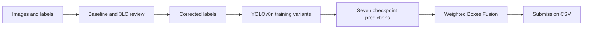

# Cotton Weed Detection — 10th Place Kaggle Solution

YOLOv8n object detection for **carpetweed, morningglory, and Palmer amaranth** in cotton fields. This competition project combines label inspection and correction in **3LC**, varied YOLOv8n training runs, and **Weighted Boxes Fusion (WBF)** across seven checkpoints.

| Result | Value |
| --- | --- |
| Final placement | **10th place** |
| Public leaderboard score | **0.87430** |
| Private leaderboard score | **0.82953** |
| Competition metric | mAP at IoU 0.50 |
| Detector | YOLOv8n, 640-pixel inference |

These are detection scores, not classification accuracy. See the [published solution](https://www.kaggle.com/competitions/the-3lc-cotton-weed-detection-challenge/writeups/10th-place-solution-yolov8n-with-pseudo-ensemblin) for the reported placement and scores.

[Competition](https://www.kaggle.com/competitions/the-3lc-cotton-weed-detection-challenge) · [Kaggle notebook](https://www.kaggle.com/code/nishantvalvi1504/the-3lc-cotton-weed-detection-challenge) · [Trained checkpoints](https://www.kaggle.com/models/nishantvalvi1504/3cl-cotton-weed-det-yolov8n-models) · [Corrected labels](https://www.kaggle.com/datasets/nishantvalvi1504/3cl-cotton-weed-det-final-labels) · [Detailed write-up](writeup.md)

## Approach

1. Train a short baseline and inspect predictions alongside labels in the 3LC Dashboard.
2. Review missing boxes, misplaced boxes, and class confusion. Export corrected labels and convert them to YOLO format.
3. Train YOLOv8n variants using AdamW/SGD, different augmentation settings, seeds, and training durations.
4. Run seven checkpoints on each test image and fuse their predictions into one submission CSV.



The final notebook uses per-model NMS at IoU **0.90**, then WBF at IoU **0.45**, with a **0.01** confidence/skip threshold. Checkpoint order is **A, B, C, D1, D2, D3, E**, with weights **[1, 1, 0.75, 0.5, 0.5, 1, 1]**.

## Label inspection

Examples from the original 3LC workflow:


## Detailed setup and workflow

This repository contains my solution for the **3LC Cotton Weed Detection Challenge**. The workflow is:

1. **Phase 1 – Label Cleaning with 3LC**
   Run `cotton_weed_starter_notebook.ipynb` locally to train a short YOLOv8n baseline, send runs to 3LC, inspect errors in the Dashboard, and export corrected labels.
2. **Phase 2 – Final Training on Kaggle**
   Upload the corrected labels as a Kaggle dataset and run `Kaggle_training_code.ipynb` to train longer YOLOv8n models and generate the competition submission.

The final solution uses only **YOLOv8n** models and improves performance mainly through **better labels** and **ensembling**.

---

## Repository Structure

```text
.
├── 3LC dashboard screenshots/      # Example screenshots for reference (optional)
├── kaggle_cotton_weed_detection.zip # Archived 3LC run/table history
├── cotton_weed_starter_notebook.ipynb  # Phase 1: 3LC label-cleaning notebook
├── Kaggle_training_code.ipynb          # Phase 2: final training & inference
├── README.md                           # This file
├── writeup.md                          # Detailed solution narrative
└── .gitignore                          # Local files and generated outputs
```

---

## 1. Environment Setup (3LC + Ultralytics)

> This section is adapted from the official 3LC starter notebook so you can reproduce the setup directly from this README.

### Before You Begin

This project uses **3LC (Three Lines of Code)** for data-centric AI workflows. Follow these steps to set up your environment.

#### Video Guide

Watch the full setup walkthrough: [3LC Quickstart Video](https://www.youtube.com/watch?v=zdIq1QpeSI8&list=PLFOZfHCPrAhDbgmxYcu9Qq5UUVMf7YLFy)

---

### Step 1: Create a 3LC Account

1. Go to [https://account.3lc.ai](https://account.3lc.ai)
2. Create your account

   * **Note:** A default workspace is automatically created for you (visible after login)
   * Your workspace name is what others on your team will see when collaborating
3. Get your API key from [https://account.3lc.ai/api-key](https://account.3lc.ai/api-key) and save it for the next step

---

### Step 2: Set Up Python Environment (Recommended)

Install [uv](https://docs.astral.sh/uv/getting-started/installation/) first. Use a separate environment for 3LC label review and the final Kaggle inference dependencies.

#### Create a Virtual Environment

**Windows:**

```bash
uv venv --python 3.11 cotton-weed-env
.\cotton-weed-env\Scripts\Activate.ps1
```

**Linux/MacOS:**

```bash
uv venv --python 3.11 cotton-weed-env
source cotton-weed-env/bin/activate
```

> You can skip this if you prefer to use your current Python environment.

---

### Step 3: Install 3LC and Dependencies

#### ⚠️ Important: PyTorch GPU Setup (For GPU Training)

The 3LC installation includes PyTorch dependencies. The installed CPU/CUDA build depends on your platform and package selection; check GPU availability before training.

**If you have a GPU and want to use it for training:**

1. First, install 3LC:

   ```bash
   uv pip install 3lc-ultralytics
   ```
2. Then, **reinstall PyTorch with CUDA support:**

   ```bash
   # Historical CUDA 11.8 example; check compatibility before using
   uv pip install torch torchvision --index-url https://download.pytorch.org/whl/cu118

   # Historical CUDA 12.1 example; check compatibility before using
   uv pip install torch torchvision --index-url https://download.pytorch.org/whl/cu121
   ```

   Visit [PyTorch Get Started](https://pytorch.org/get-started/locally/) to find the correct command for your CUDA version.

**If you're fine with CPU training (slower but works):**

```bash
uv pip install 3lc-ultralytics
```

**What gets installed:**

* `3lc-ultralytics` – 3LC integration with Ultralytics YOLO
* `3lc` – Core 3LC library
* `ultralytics`, `torch`, `pandas`, `numpy`, `pillow`, `pycocotools`, and other dependencies

**System Requirements:**

* The original setup listed Python 3.8+; the optional local examples here use Python 3.11. Check your selected 3LC/PyTorch releases for supported versions.
* Windows 10+, Linux, or macOS
* GPU with CUDA (optional but recommended for faster training)

---

### Step 4: Login to 3LC

Once finished with installation, in the **same terminal** login using an API key. [Create one if not present](https://account.3lc.ai/api-key).
Replace `<your_api_key>` with your actual API key:

```bash
3lc login <your_api_key>
```

This saves your API key locally. **For future sessions, you don't need to run this again.**

---

### Step 5: Start the 3LC Service (for Dashboard visualization)

**Important Clarification:**

* The 3LC service is **NOT required for training** – you can train models without it
* It **IS required** if you want to use the 3LC Dashboard to visualize and analyze your data/runs
* Since the Dashboard is a key part of the data-centric workflow, we recommend starting it

**To start the service, run in the terminal:**

```bash
3lc service
```

**What happens:**

* Starts the local service for Dashboard connectivity
* Loads some preloaded example projects to help you learn 3LC
* These examples are useful for getting familiar with the Dashboard features

**Keep this terminal open while using the Dashboard.** To stop: press `Q` or `Ctrl+C`.

---

### Step 6: Open 3LC Dashboard (for visualization)

Once the service is running, open [https://dashboard.3lc.ai](https://dashboard.3lc.ai) in your browser.

**Browser Requirements:**

* Chrome (recommended), Firefox, or Edge (latest versions)
* Hardware acceleration enabled (GPU) for smoother experience
  (see the [3LC GPU Acceleration Guide](https://docs.3lc.ai/3lc/latest/user-guide/dashboard/gpu-acceleration.html))

**Tip:** Explore the preloaded example projects to learn Dashboard features before working on competition data.

---

### Verification Checklist

Before running any notebook, ensure:

1. ✅ 3LC account created and API key obtained
2. ✅ Python environment activated (if using venv)
3. ✅ `3lc-ultralytics` installed
4. ✅ PyTorch GPU version installed (if you have a GPU)
5. ✅ Logged in to 3LC (`3lc login <api_key>`)
6. ✅ 3LC service running and Dashboard open (optional but recommended)

**For future sessions:** Only steps 2 and 6 are needed (activate environment and optionally start service/Dashboard).

---

### Additional Resources

* [3LC Documentation](https://docs.3lc.ai/)
* [3LC Example Notebooks](https://github.com/3lc-ai/3lc-examples?tab=readme-ov-file)
* [Getting Started Video Playlist](https://www.youtube.com/watch?v=zdIq1QpeSI8&list=PLFOZfHCPrAhDbgmxYcu9Qq5UUVMf7YLFy)

---

### Troubleshooting

* **"3lc: command not found"** → Activate your Python environment or reinstall `3lc`
* **"API key invalid"** → Check your API key at [https://account.3lc.ai/api-key](https://account.3lc.ai/api-key)
* **"No GPU detected" during training** → Reinstall PyTorch with CUDA support (see Step 3)
* **"Cannot connect to Dashboard"** → Make sure `3lc service` is running in a terminal

---

## 2. Dataset Configuration

The competition dataset is organized in YOLO format with `train`/`val`/`test` splits already prepared.

### Dataset Structure

```text
cotton_weed_dataset/
├── train/images/        # 542 training images
├── train/labels/        # YOLO label files; counts can change after label cleaning
├── val/images/          # 133 validation images
├── val/labels/          # 133 YOLO label files
├── test/images/         # 170 test images (no labels provided)
└── dataset.yaml         # Configure locally; the final notebook generates its own YAML
```

### Test Set Information

The test set contains **170 images** split as follows:

* **Public leaderboard**: 85 images (50%)
* **Private leaderboard**: 85 images (50%)

> All 170 test images are included in the download for convenience. Only the public/private split determines which images are used for each leaderboard score.

### YOLO Label Format

Each `.txt` file contains bounding boxes in the form:

```text
class_id x_center y_center width height
```

All coordinates are normalized to `[0, 1]`.

### ⚠️ Data Quality Note

This dataset includes labeling imperfections. The whole point of this project is to use 3LC and a **train–fix–retrain** loop to identify and fix these issues before running long trainings.

---

## 3. How to Run – Phase 1: 3LC Label Cleaning

1. **Download the competition dataset** and arrange it as described in [Dataset Configuration](#2-dataset-configuration).
2. Ensure your 3LC environment is set up and the Dashboard is running.
3. Open `cotton_weed_starter_notebook.ipynb` in Jupyter / VS Code / your IDE.
4. Configure the dataset path inside the notebook (point it to `cotton_weed_dataset/`).
5. Run the notebook:

   * Train a short YOLOv8n model (few epochs) with 3LC tracking enabled.
   * Sync the run to 3LC and open it in the Dashboard.
   * Use the Dashboard to find missing boxes, misaligned boxes, and class confusions (especially Carpetweed / Morningglory / Palmer Amaranth).
6. After several passes of corrections, export the corrected labels from 3LC (CSV) and convert them back to YOLO TXT format. The final notebook contains the conversion used for the exported labels. The starter's optional `update_labels` helper is preserved as historical code; check box coordinate semantics against your 3LC table schema before using it.
7. Save the cleaned dataset (e.g. as `cotton_weed_dataset_cleaned/`) – this is what will be used for Phase 2.

---

## 4. How to Run – Phase 2: Final Training on Kaggle

1. Create a **Kaggle Dataset** from the cleaned labels (mirroring the original YOLO folder structure).
2. Open `Kaggle_training_code.ipynb` on Kaggle (or locally, if you prefer) and attach the cleaned dataset.
3. Configure paths (input dataset, working directory) in the first cells.
4. Run the notebook to:

   * Use the saved, commented training recipes to train YOLOv8n variants when explicitly enabled.
   * Evaluate on a held-out validation split during development. The final full-data training configuration overlaps train and validation; see the evaluation note below.
   * Run inference on the test set.
   * Optionally ensemble predictions using Weighted Boxes Fusion (WBF) and create a submission CSV.
5. The competition submission artifact is a CSV, not a ZIP. The challenge has ended; the reported scores are from the original competition.

> In my final solution, all models were trained on the **3LC-corrected labels only**, and the reported final result uses the ensemble of several YOLOv8n runs. The detailed write-up describes its improvement over individual models; this repository does not include a controlled per-model comparison table.

---

## 5. Dependencies Summary

* Python compatible with your 3LC and PyTorch versions (local examples use 3.11)
* [`3lc-ultralytics`](https://pypi.org/project/3lc-ultralytics/)
* `torch`, `torchvision` (GPU build recommended)
* `ultralytics`
* `numpy`, `pandas`, `tqdm`, `matplotlib`, `pillow`, `pycocotools`
* (Optional, for ensembling) `ensemble-boxes`

The 3LC installation provides its dependencies. Verify the tools needed for your chosen workflow after following the commands in the [Environment Setup](#1-environment-setup-3lc--ultralytics) section, except `ensemble-boxes`, which you can add via:

```bash
uv pip install ensemble-boxes
```

---

## 6. Notes & Tips

* Keep Phase 1 training **short** – its purpose is to surface label issues, not to be the final model.
* When in doubt about weed species (e.g. Palmer Amaranth vs Waterhemp), prefer **conservative edits** rather than overconfident relabeling.
* Back up your original labels before overwriting them with the cleaned versions.
* Save intermediate 3LC exports so you can compare label quality across iterations.

---

## 7. Optional: Kaggle Resources

If you want to see the full Kaggle pipeline and artifacts, you can refer to:

* **Solution Notebook:** [https://www.kaggle.com/code/nishantvalvi1504/the-3lc-cotton-weed-detection-challenge](https://www.kaggle.com/code/nishantvalvi1504/the-3lc-cotton-weed-detection-challenge)
* **Trained YOLOv8n Models:** [https://www.kaggle.com/models/nishantvalvi1504/3cl-cotton-weed-det-yolov8n-models](https://www.kaggle.com/models/nishantvalvi1504/3cl-cotton-weed-det-yolov8n-models)
* **Corrected Labels Dataset:** [https://www.kaggle.com/datasets/nishantvalvi1504/3cl-cotton-weed-det-final-labels](https://www.kaggle.com/datasets/nishantvalvi1504/3cl-cotton-weed-det-final-labels)

## Run on Kaggle

The competition workflow stays in notebooks. To run inference without retraining:

1. Copy the [published notebook](https://www.kaggle.com/code/nishantvalvi1504/the-3lc-cotton-weed-detection-challenge), or upload `Kaggle_training_code.ipynb` from this repository.
2. Attach the competition dataset, corrected-label dataset, and PyTorch/default/version 1 of the trained checkpoints linked above. Enable Internet for dependency setup; a GPU is recommended for seven-model inference.
3. Follow the notebook's original Kaggle setup, then check `SRC_ROOT`, `WORK_ROOT`, `CSV_BY_SPLIT`, and `MODEL_PATHS`. Input paths can change with dataset/model versions. The notebooks are preserved as competition artifacts, including their original setup commands.
4. Run data preparation and inference. Tuning and training recipes are commented out and do not launch training automatically.
5. Download `/kaggle/working/submission.csv`. Its columns are `image_id,prediction_string`. Each detection is `class confidence x_center y_center width height` with normalized coordinates. Images without detections receive `no box`.

The notebooks have not been rerun as part of this documentation update. Their saved outputs describe the original runs.

## Optional local notebook setup

Use Python 3.11 and [uv](https://docs.astral.sh/uv/). From the repository directory:

```powershell
uv venv --python 3.11
uv pip install --python .venv/Scripts/python.exe "ultralytics==8.2.103" "ensemble-boxes==1.0.9" "numpy<2" pandas tqdm jupyterlab
uv run --no-project jupyter lab
```

On Linux/macOS, replace `.venv/Scripts/python.exe` with `.venv/bin/python`. `uv pip` is uv's package installer; a separate pip installation is not required. This is an optional setup starting point, not a verified recreation of the historical Kaggle environment. The original notebook setup cells may be skipped when dependencies have already been installed with uv.

Download the checkpoints from the model page into `weights/`, obtain the competition data through Kaggle, and edit the notebook's Kaggle-specific paths to your local directories. Credentials, dataset images, and model weights are not bundled.

For label review, install `3lc-ultralytics` and Jupyter in a **separate uv environment**, following the [3LC documentation](https://docs.3lc.ai/). Open `cotton_weed_starter_notebook.ipynb` and configure its dataset YAML and checkpoint paths. Its optional custom-checkpoint cell has an example local path that must be replaced or skipped. The starter records the exploratory workflow; the final Kaggle notebook contains the submitted ensemble approach.

## Evaluation notes

Final training includes **both train and validation images**. Its validation metrics therefore are not independent evaluation. For tuning or held-out evaluation, train on `train/images` only and reserve `val/images`. The private leaderboard score is the reported hidden-test result.

Training recipes and saved outputs are included, but not every training run is captured as a fully automated reproduction. There is no controlled ablation table isolating the effects of label corrections and fusion. Field deployment performance has not been measured.

## Data use and acknowledgements

Follow the [competition rules](https://www.kaggle.com/competitions/the-3lc-cotton-weed-detection-challenge/rules) when using the data. Access and redistribution restrictions apply; download images from the authorized source rather than republishing the dataset. Public demos should use uploads or examples with suitable permission.

Thanks to the organizers, the CottonWeedDet3 authors, 3LC, Ultralytics, and the [Weighted Boxes Fusion authors](https://arxiv.org/abs/1910.13302).
